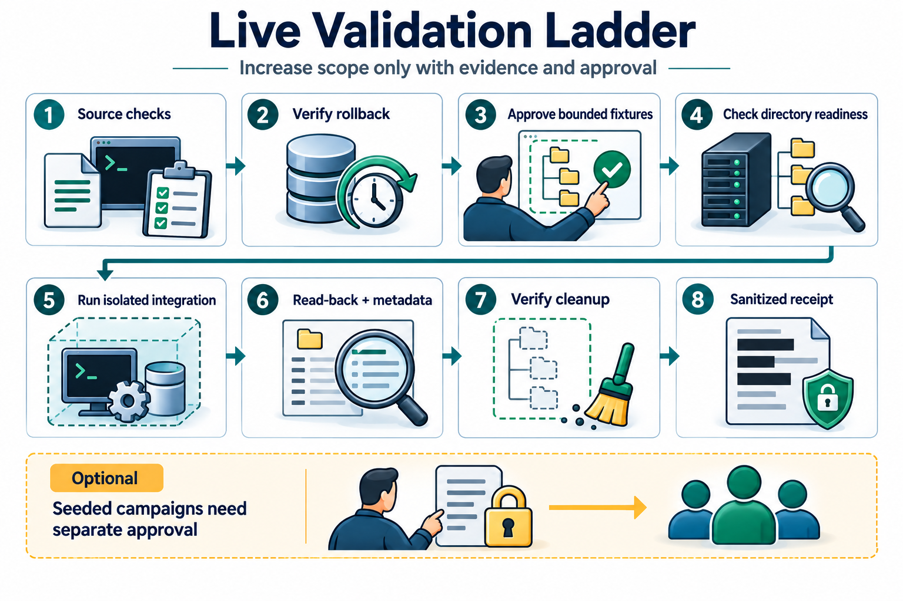
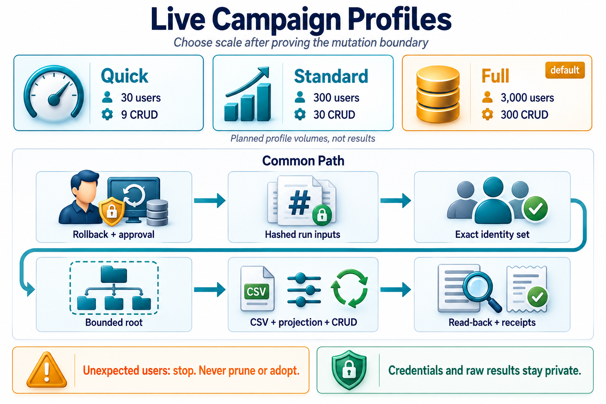

# DrunkenAD Operations Runbook

This runbook is for operators who need to validate, write, ingest, project, or
remove DrunkenAD values in a live Active Directory environment.

See the current [schema readiness flow](DIAGRAMS.md#schema-readiness-flow).

The source diagram for this page lives at
[diagrams/schema-readiness-flow.mmd](diagrams/schema-readiness-flow.mmd).

## Before Any Live Write

1. For coordinated writes, select one common writable DC by its actual hostname
   for all producers of the affected users' `drink` attribute, including
   different prefixes. Use explicit `-DomainController` on each write command.
2. Import the module.
3. Check schema readiness.
4. Confirm the workflow's owned prefixes.
5. Use `-WhatIf` where the command supports it.

Use that same DC for reads feeding writes. Do not let individual producers
independently choose a replacement during failover. Domain names, NetBIOS domain
names and aliases do not establish this shared physical target. This operating
guidance does not change accepted API parameters or certify multi-DC behavior.
Same-prefix producers still need external serialization; see
[concurrency limits](DATA-STORE.md#replacement-semantics).

RODCs are not supported write targets by
[Set-ADUser](https://learn.microsoft.com/en-us/powershell/module/activedirectory/set-aduser?view=windowsserver2025-ps#notes).
Schema readiness is not a write-permission or writable-controller check.

```powershell
Import-Module .\DrunkenAD\DrunkenAD.psd1 -Force

Test-ADDrinkAttributeReadyForUserWrite `
    -Server 'dc01.contoso.com' `
    -PassThru | Format-List
```

If `ReadyForUserWrite` is not `True`, stop and follow
[SCHEMA-ENABLEMENT.md](SCHEMA-ENABLEMENT.md).

## Delegated Access

Delegate only **Write drink** on descendant user objects in one designated OU
to the writer. It also needs directory visibility, schema reads, and read access
to the user identity and `drink` values. The reader needs those reads but no
write grant. Check effective rights, including inherited group grants. Neither
role needs account creation, deletion, schema changes, or broad write access.
The permission applies to the whole attribute: prefixes are application rules,
not an AD authorization boundary.

Delegated and read-only accounts, a member server with RSAT, and live AD under
PowerShell 7 have **not** been validated. The October live evidence was collected
as an administrator on a domain controller under native Windows PowerShell 5.1.

## Select a Directory Identity

All directory-facing module commands, their compatibility wrappers, and the CSV
import example accept an optional `-Credential` (`PSCredential`). For example:

```powershell
$operator = Get-Credential
Get-ADUserDrinkData -SamAccountName 'alice.bennett' -DomainController 'dc01.contoso.com' -Credential $operator
```

The same identity is used for schema discovery, inherited-class checks, user
lookups, CSV refreshes and writes. Omit the parameter to retain the AD cmdlets'
normal authentication behavior; a failed credential is not retried as the caller.
The credential grants no additional rights and does not change the selected DC.
It does not impersonate the operator for local CSV, config, report or log files.
Credentials are not included in DrunkenAD activity logs or results.
Do not serialize raw PowerShell diagnostic records: their invocation metadata
can include bound parameters even when the displayed message does not.

The offline CSV splitter needs no credential. Live validation harnesses are
not operator entrypoints for alternate credentials. Propagation has mock coverage;
it is not a native Windows authentication or permission test.

## Generic Namespace Write

Use `Set-ADUserDrinkData` for direct namespace writes:

```powershell
Set-ADUserDrinkData `
    -SamAccountName 'alice.bennett' `
    -DataMap @{
        'AppProfile-' = @('Tier=Gold', 'Region=NA')
        'Flags-'   = @('Enabled', 'Audited')
    } `
    -DomainController 'dc01.contoso.com' `
    -WhatIf
```

Remove `-WhatIf` only after the preview matches the intended prefix ownership.

## CSV Ingestion

Use the sample mapping as a starting point:

```powershell
Import-ADUserDrinkCsvData `
    -CsvPath .\examples\data\drink-ingestion-sample.csv `
    -ConfigPath .\examples\data\drink-ingestion-config.json `
    -DomainController 'dc01.contoso.com' `
    -WhatIf
```

The sample CSV map owns `CsvProfile-`, `Flags-`, `CsvRouting-`, `Tenant-`, and
`Sync-`, separate from the default projection. Custom maps must also avoid
unintended overlap. Entirely blank mapped namespaces remain unchanged unless
`-ClearBlankNamespaces` is supplied. Save CSV sources as UTF-8; invalid byte
sequences and incomplete CSV records fail before AD
access. Confirmation uses refreshed counts and stops if the approved delta
changes before writing. See [CSV guidance](HOW-TO-INGEST-CSV.md#blank-cells-and-existing-imports).

## Attribute Projection

Use projection when AD attributes should be copied into namespaced records:

```powershell
Set-ADUserDrinkProjection `
    -SamAccountName 'alice.bennett' `
    -IncludeDefaultAttributeMap `
    -AttributeMap @{ 'Org-' = @('department', 'title') } `
    -DomainController 'dc01.contoso.com' `
    -Confirm:$false
```

Projection replaces the prefixes in its effective attribute map. Review the map
before using it in the same prefix space as CSV ingestion.

## Removal

Remove only the prefixes you intend to own:

```powershell
Remove-ADUserDrinkData `
    -SamAccountName 'alice.bennett' `
    -Prefixes @('Scenario-', 'Literal[01]-') `
    -DomainController 'dc01.contoso.com' `
    -WhatIf
```

## Activity Logs

The compatibility writer's `-EnableLogging` uses the current user's local
application-data directory, under `DrunkenAD/logs-v1`. If that private root is
unavailable, logging warns and requires an explicit path instead of falling
back to shared temporary storage. It reuses `activity.log`, rotating to
`activity.previous.log`, with at most 1 MiB per file. Entries carry a module
session identifier, ObjectGUID, and counts, not account names or attribute
values. Treat GUIDs as persistent identifiers and protect logs accordingly.
Rotation is restricted to recognized module-owned files and rejects links.
Older GUID-named logs are not automatically deleted.
Preview mode does not append or rotate activity logs.

Supply one `-LogPath` across commands for a caller-managed batch log. Explicit
paths are append-only and are not automatically rotated; manage their access
and retention. Logging is best effort: a failure emits a warning, not a false
directory-write failure. A `Written` status is evidence that the directory call
succeeded, not a guarantee that a log record was stored.
Logging warnings honor `-WarningAction SilentlyContinue` and `Ignore`.
Other warning preferences, including `Stop` and `Inquire`, remain nonterminating
for logging only, so a failed log cannot invalidate a completed directory write.

## Live Validation

Use the live campaign when you need end-to-end evidence across schema readiness,
temporary smoke writes, seeded users, CSV ingestion, projection, and CRUD.





The source diagram for this validation path lives at
[diagrams/live-validation-ladder.mmd](diagrams/live-validation-ladder.mmd).
The profile source diagram lives at
[diagrams/live-campaign-profiles.mmd](diagrams/live-campaign-profiles.mmd).

Before running a live campaign:

- confirm a VM snapshot or equivalent rollback point
- preview the host campaign with `-WhatIf` before approving mutation
- provide `DRUNKENAD_SEED_PASSWORD` through the guest process environment only
- never write the seed password to a tracked file or run artifact
- confirm that `tests/Live/results/` is ignored by Git
- confirm the selected host wrapper can create or verify the rollback point,
  expose the repository workspace, run the guest-side script, and collect reports
- verify the operator notes contain the run-specific input paths and SHA-256 hashes
- stop if an unexpected user exists under the bounded campaign root; the harness will not prune it
- use a timeout long enough for thousands of AD reads and writes

Start with the quick profile when you only need a live sanity pass:

```powershell
pwsh -NoLogo -NoProfile -File /temp/DrunkenAD/tests/Live/Invoke-DrunkenADLiveCampaign.ps1 `
    -CampaignProfile Quick
```

Use `Standard` for 300 seeded users and `Full` for the full 3,000-user
campaign. `Full` is the default profile for compatibility with earlier runs.

The May 7, 2026 WinServer campaign took about 31 minutes for 3,000 seed users,
3,000 CSV writes, 3,000 projection writes, and 300 CRUD samples.

## Rollback

For the lab VM, restore the pre-mutation snapshot. For a broader AD forest,
follow the organization's schema-change recovery process. This repo documents
the checks and guardrails, but it does not automate rollback from schema changes.

## Export For Review

```powershell
Export-ADUserDrinkData -SamAccountName 'ReviewerA','ReviewerB' -Prefix 'AppProfile-' -DomainController 'dc01.contoso.com' -Path './review.json'
```

Use exact, distinct account names and one literal prefix. Supply `-Credential`
with a PSCredential to use an alternate reader for both schema and user lookups.
The format is UTF-8 JSON without a BOM:

```json
{"schemaVersion":1,"prefix":"AppProfile-","users":[{"samAccountName":"ReviewerA","values":["AppProfile-East","AppProfile-West"]},{"samAccountName":"ReviewerB","values":[]}]}
```

Users follow request order. Values are complete strings, matched by ordinal
case-insensitive prefix and sorted in ordinal order. Both collections are
always arrays; an empty values array means no matching values were returned.
A missing or ambiguous account fails the whole export. This is a plaintext
review file, not a backup or an input format for the CSV importer. Choose a
private existing directory and a fresh filename for each run. The command
never replaces an existing file and publishes only after all reads succeed.
